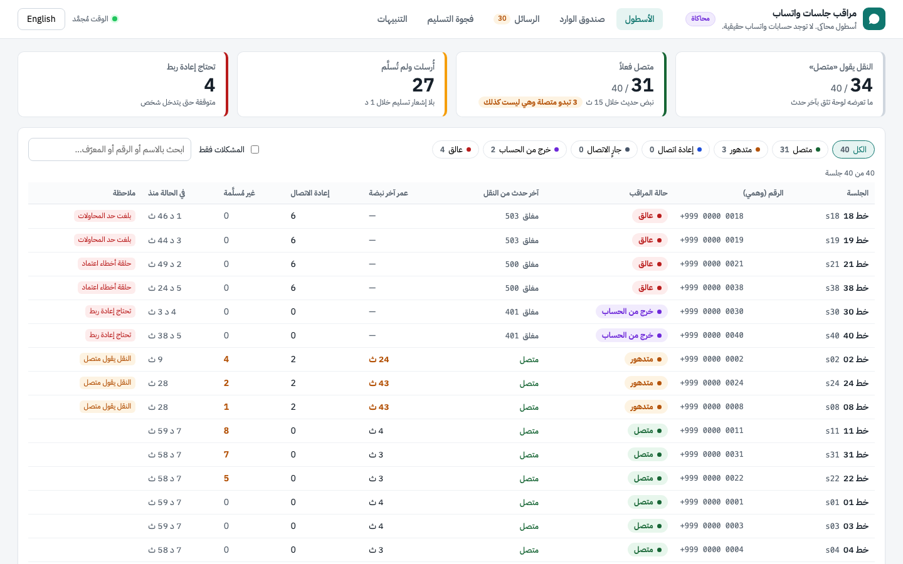
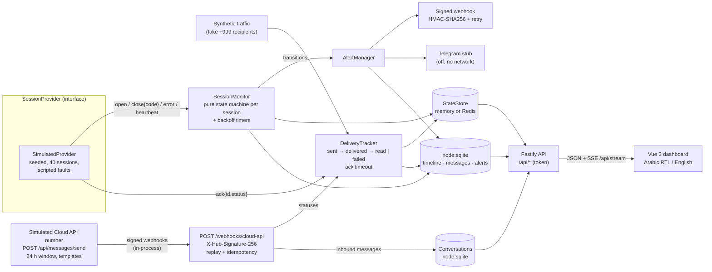
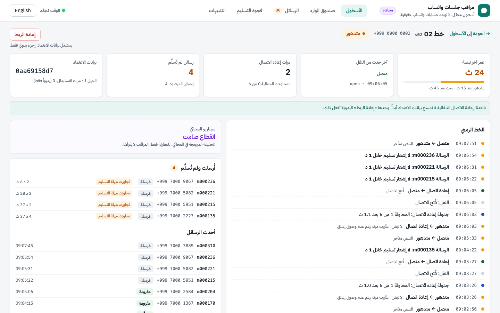
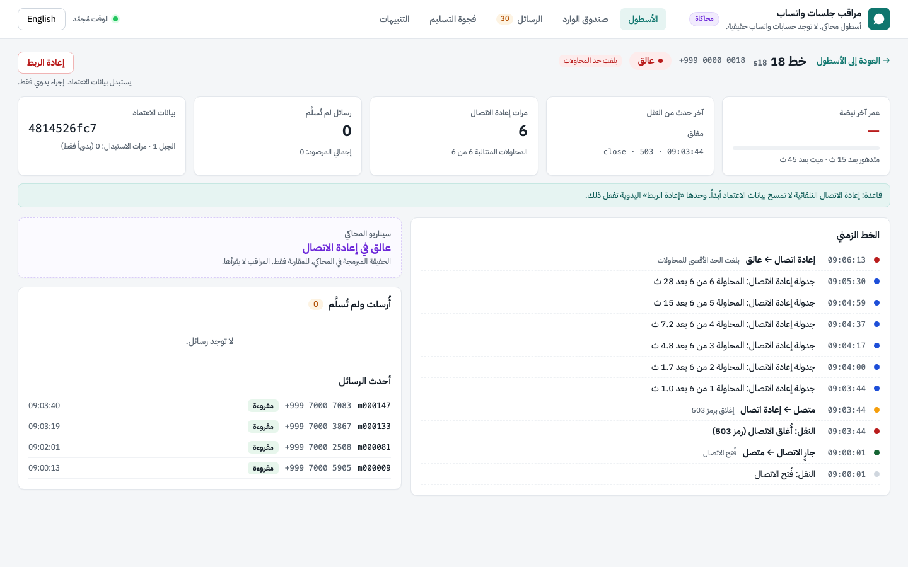
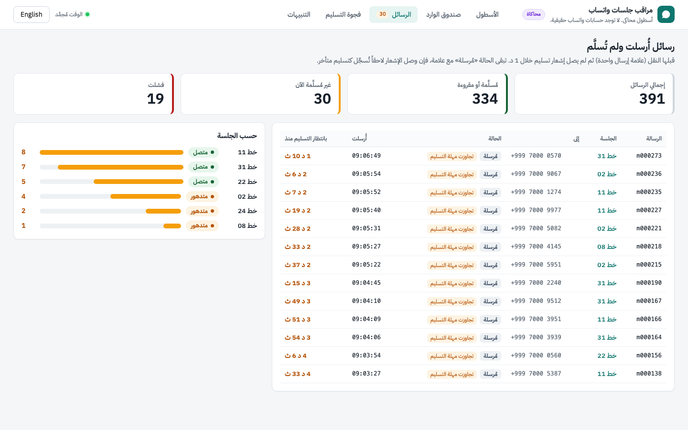
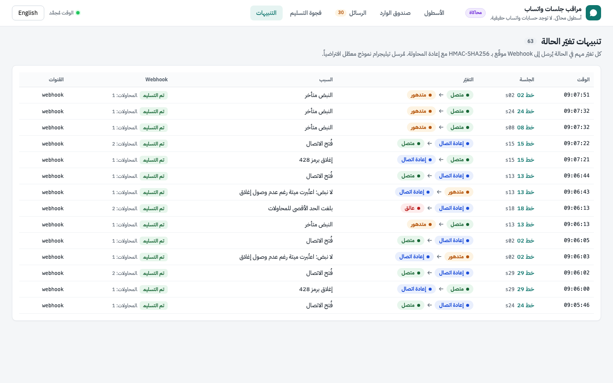
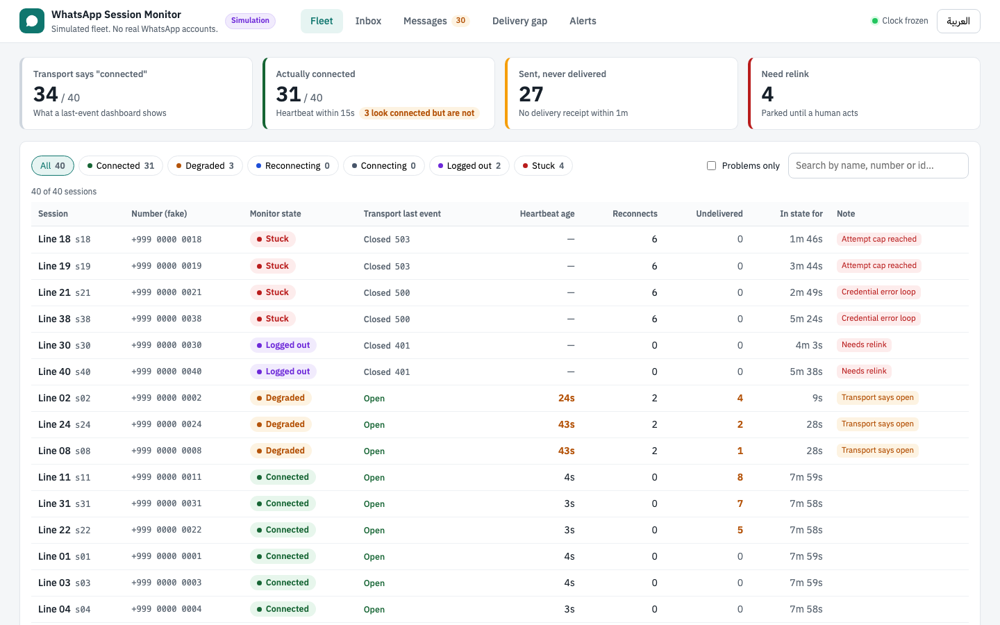
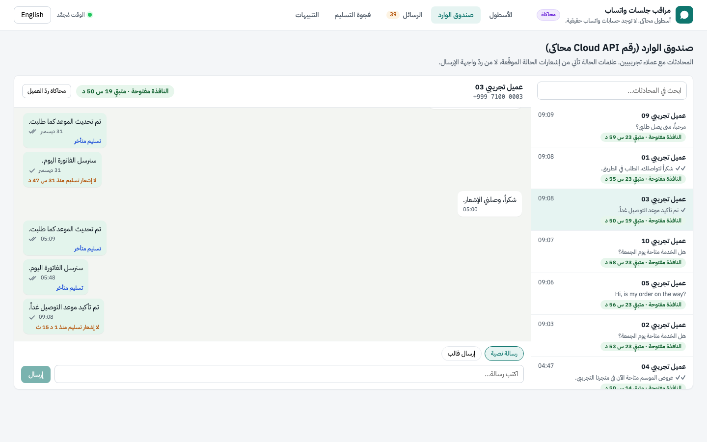
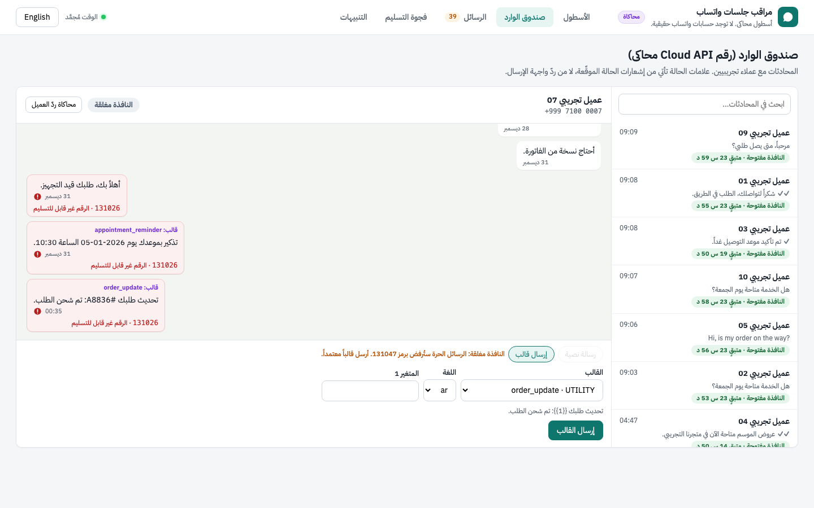
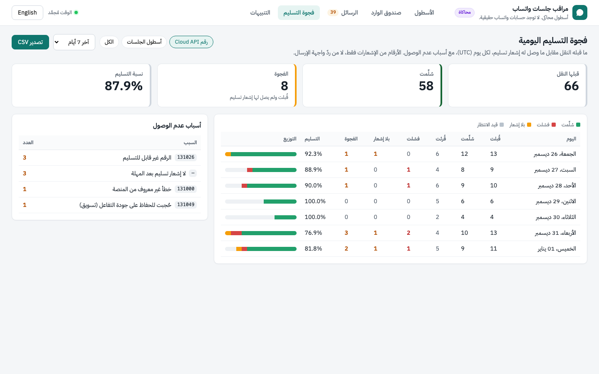

# whatsapp-session-monitor-demo

**Simulated fleet. No real WhatsApp accounts.**

<div dir="rtl" lang="ar">

### ملخص بالعربية

مشروع تجريبي يراقب أسطولاً محاكى من جلسات واتساب ورقماً محاكى على WhatsApp Cloud API. لا يتصل بواتساب ولا بـ Meta، وكل الأرقام والبيانات تخيلية.

يعرض ثلاث مشكلات شائعة: جلسة تنقطع دون أن يصل حدث إغلاق، ولوحة تعرض «متصل» والجلسة متوقفة، ورسالة قبلتها واجهة الإرسال ولم تصل إلى العميل. حالة الجلسة تُحسب من عمر آخر نبضة، وحالة الرسالة من إشعارات الحالة الموقّعة فقط (أُرسلت، سُلِّمت، قُرئت، أو فشلت مع رمز الخطأ)، لا من ردّ واجهة الإرسال.

يتضمن صندوق وارد بالعربية والإنجليزية فيه علامات التسليم وعدّاد نافذة الـ24 ساعة، وتقريراً يومياً لفجوة التسليم مع أسباب الفشل وتصدير CSV. حدود المشروع مذكورة بوضوح في قسم [Honest limits](#honest-limits).

التشغيل: `npm ci` ثم `npm run demo`، وافتح الرابط الذي يظهر في الطرفية.

</div>

A monitor for a simulated fleet of 40 WhatsApp-style sessions. It shows three failure modes that multi-session setups run into, and how to detect each one:

- sessions that **drop silently**: no close event, the socket just stops carrying traffic
- dashboards that say **"connected" while the session is dead**, because they trust the last transport event
- messages that **look sent but never arrive**: accepted by the transport, with no delivery receipt ever

It also runs a **simulated WhatsApp Cloud API number** with an inbox, the 24-hour customer service window, Meta-shaped errors, and signed status webhooks, plus a **daily delivery-gap report** (accepted vs delivered, by failure reason, CSV export). See [Simulated Cloud API number](#simulated-cloud-api-number).

Node 22 + TypeScript, Fastify, `node:sqlite`, an optional Redis state store, and a Vue 3 dashboard (Arabic RTL by default, with an English toggle) served by the same process with live SSE updates.



## What it is / what it is not

| It is | It is not |
| --- | --- |
| A simulator plus a monitor. A seeded `SimulatedProvider` scripts the failures; the monitor detects them without knowing the script. | A WhatsApp client. Nothing in this repo connects to WhatsApp. There is no Baileys or any other unofficial client. |
| A reference for session state, heartbeat-age truth, reconnect backoff, ack timeouts and signed alert webhooks. | A bulk-messaging tool. `POST /api/messages` sends one message, through the simulator, to a fake number. |
| A parser for the publicly documented WhatsApp Cloud API `statuses` webhook, tested against hand-written fixtures. | Connected to Meta. The Cloud API endpoint only receives and verifies webhooks you send it. |
| A simulated Cloud API number that answers `POST /api/messages/send` like the real endpoint and reports outcomes only by signed webhook. | A Cloud API client or SDK. There are no Meta tokens, no Graph API calls, and no template management. |

All phone numbers use `+999`, which is not an assigned country code. Every count in the dashboard comes from the seeded simulation, not from real usage.

## Failure modes it demonstrates

The default fleet (seed `42`) has 40 sessions: 27 healthy (a few of them blip with a normal `428` close and reconnect), plus these scripted scenarios:

| Scenario (sessions) | What the transport reports | What a last-event dashboard shows | What this monitor does |
| --- | --- | --- | --- |
| Silent drop (4) | Nothing. Heartbeats and acks stop; no close event. | "Connected" | `degraded` once the heartbeat is older than 15 s. At 45 s it declares the session dead, forces a disconnect and reconnects with backoff. |
| Logged out (2) | `close` with code `401` | "Disconnected" (and many setups retry forever) | `logged_out`. No automatic retry, credentials kept, flagged "needs relink". |
| Credential-error loop (2) | `open`, then a credential `error`, then `close 500`, on every attempt | Flaps between connected and disconnected | Backoff up to the attempt cap, then `stuck` with reason `credential_error_loop`. Credentials are **not** wiped. |
| Stuck reconnecting (2) | After a `503` close, every connect hangs: no open, no close | "Connecting…" forever | Connect timeout per attempt, exponential backoff, then `stuck` (reason `reconnect_cap`). It stops hammering. |
| Never acked (3) | Heartbeats fine; messages accepted (`sent`) but never `delivered` | "Connected" | Session stays `connected` (it is). The delivery tracker flags each message after 60 s and counts it against the session. |

Messages sent into a silently dropped session also end up as "sent but never delivered". The synthetic traffic generator sends whenever the transport *looks* open, as a naive sender would.

## Architecture



- **`src/provider/`**: the `SessionProvider` interface, the seeded `SimulatedProvider` and the synthetic traffic generator.
- **`src/monitor/state-machine.ts`**: a pure reducer, `(record, input) → (record, effects)`. Every transition and the credential rule are unit-tested without timers.
- **`src/monitor/monitor.ts`**: feeds provider events and a 1 s tick into the reducer and runs its effects (connect, disconnect, timers).
- **`src/delivery/tracker.ts`**: message lifecycle and the ack-timeout rule.
- **`src/store/`**: `node:sqlite` history (no native build) and the current-state store (memory, or Redis via `REDIS_URL`).
- **`src/alerts/`**: alert rules, the signed webhook sender, and the Telegram stub.
- **`src/cloud-api/`**: Cloud API webhook parsers (statuses, inbound messages) and the signature check.
- **`src/cloud/`**: the simulated Cloud API number (send rules, templates, 24 h window, Meta-shaped errors, webhook payloads) and its conversation store.
- **`src/reports/`**: the delivery-gap report and CSV export.
- **`web/`**: the Vue 3 + Vite dashboard, built into `dist/web` and served by Fastify.

### Session states

| State | Meaning |
| --- | --- |
| `connecting` | Connect called, waiting for `open` (15 s connect timeout). |
| `connected` | Transport open **and** the last heartbeat is younger than 15 s. |
| `degraded` | Transport still says open, but the heartbeat is 15–45 s old. |
| `reconnecting` | Waiting for a backoff timer or a reconnect attempt. Backoff: 1 s, 2 s, 4 s, 8 s, 16 s, capped at 30 s, ±20 % jitter. |
| `logged_out` | `401` close. Parked: no automatic retry. |
| `stuck` | More than 6 consecutive failed attempts. Parked until a human acts. |

The source of truth is **heartbeat age, not the last event**. The attempt counter resets only after a connection has stayed healthy for 30 s, so open-then-fail loops still reach the cap.

### The credential rule

> Automatic recovery never wipes credentials. Only an explicit user **relink** does.

Reconnects, backoff, heartbeat timeouts, `401`, credential-error loops and reaching the attempt cap all keep the stored credentials. They park the session (`logged_out` / `stuck`, `needsRelink: true`) for a human to decide. In the reducer, only the `relink` input can emit the `wipe_credentials` effect (`src/monitor/state-machine.ts`). This is tested three ways:

- a fuzz test feeds 2,000 random sequences of every non-relink input and asserts that no `wipe_credentials` effect ever appears (`test/state-machine.test.ts`)
- monitor tests with fake timers run each failure scenario against a spy on `CredentialStore.wipe` (`test/monitor.test.ts`)
- an API test checks that `POST /api/sessions/:id/relink` replaces the credentials (generation +1) and reconnects (`test/api.test.ts`)

### Delivery tracking

Each outbound message moves `sent → delivered → read`, or ends in `failed`. Receipts never move a message backwards: a late `delivered` after `read` is ignored. If a message is still only `sent` after `ACK_TIMEOUT_MS` (default 60 s), it is flagged `undelivered` ("sent but never delivered") and counted per session. A receipt that arrives later clears the flag and marks the message `lateDelivery`, so the incident stays visible.

## Setup

Requirements: Node.js 22.13 or newer (`node:sqlite` without a flag). Redis and Docker are optional.

```bash
npm ci
```

```bash
npm run demo
```

`npm run demo` builds the dashboard and the server, then starts the simulated fleet on the real clock, listening on `127.0.0.1:3000`. Open the URL it prints, `http://localhost:3000/?token=demo-token` (the dashboard stores the token and removes it from the address bar). The scripted faults fire within the first 4 minutes (never-acked after 20–80 s, the others after 1–4 minutes), so give it a few minutes. The dashboard updates live over SSE.

Configuration is optional: copy `.env.example` to `.env` (it is git-ignored and loaded by `npm start`). Main settings:

| Variable | Default | Purpose |
| --- | --- | --- |
| `HOST` / `PORT` | `127.0.0.1` / `3000` | Bind address and port. On a non-loopback bind, an unset `DEMO_TOKEN` is generated randomly for that run and printed at startup. An explicitly configured `demo-token` makes startup fail. |
| `DEMO_TOKEN` | `demo-token` on loopback; random otherwise | Single static token for the API and dashboard |
| `SEED` / `SESSION_COUNT` | `42` / `40` | Simulated fleet |
| `ACK_TIMEOUT_MS` | `60000` | "Sent but never delivered" threshold |
| `REDIS_URL` | empty | Use the Redis state store instead of memory |
| `ALERT_WEBHOOK_URL` / `ALERT_WEBHOOK_SECRET` | empty / `demo-webhook-secret` | Alert webhook target and HMAC secret |
| `ALERT_WEBHOOK_ALLOW_PRIVATE` | `false` | Operator-only opt-out from private-address checks for an explicitly trusted alert target |
| `DEMO_ALERT_SINK` | `true` | With no webhook URL, send alerts to the built-in verifying receiver |
| `TELEGRAM_NOTIFIER_ENABLED` | `false` | Telegram stub (formats and logs only) |
| `CLOUD_API_APP_SECRET` / `CLOUD_API_VERIFY_TOKEN` | empty | Enables `/webhooks/cloud-api` |
| `VIRTUAL_TIME_MS` | empty | Fast-forward the fleet on a virtual clock, then freeze |
| `RATE_LIMIT_MESSAGES_PER_MIN` / `RATE_LIMIT_RELINKS_PER_MIN` | `30` / `10` | Per client IP, in-process |
| `MAX_STREAMS` | `50` | Concurrent SSE connections |
| `CLOUD_SIM` | `true` | Run the simulated Cloud API number (inbox, templates, signed status webhooks) |
| `CLOUD_ENFORCE_WINDOW` | `true` | Stop free-form text outside the 24 h window before sending (`false` = Meta-like async `131047`) |
| `CLOUD_INBOUND_INTERVAL_MS` | `90000` | How often a simulated customer writes in |
| `CLOUD_MAX_EVENT_AGE_MS` | `604800000` | Webhook events older than this are ignored (replay protection) |

Invalid numbers, or `ALERT_WEBHOOK_URL` combined with the default `ALERT_WEBHOOK_SECRET`, stop the app at start-up with a clear error.

### Docker Compose (app + Redis)

```bash
docker compose up --build
```

This runs the same app with `REDIS_URL=redis://redis:6379` and `HOST=0.0.0.0` inside the container; `GET /api/health` then reports `"stateStore":"redis"`. Compose publishes port 3000 only on the host loopback (`127.0.0.1`). Set a long random `DEMO_TOKEN` in the environment, or read the per-run generated token from `docker compose logs app` and enter it in the dashboard. Binding to `0.0.0.0` inside the container is required for this mapping; it does not expose the host port to the network.

## Tests

```bash
npm test
```

Vitest. Coverage includes:

- the state machine: every transition, backoff, the attempt cap, the credential rule, heartbeat truth
- the monitor and the ack timeout, with fake timers
- simulator determinism and each scripted scenario
- the HTTP API and auth
- alert signing and retries
- the Cloud API parser and signature check, against fixtures
- the simulated Cloud API number: window rule, templates, error codes, receipts arriving through the signed webhook path
- webhook replay protection and idempotency (duplicate bodies, duplicate statuses, stale or future events)
- the delivery-gap report and its CSV
- that `docs/api.http` documents every registered route

The Redis store test runs when `REDIS_URL` is set (CI provides Redis) and is reported as skipped otherwise. To type-check:

```bash
npm run typecheck
```

## API

All `/api/*` routes except `/api/health` need `Authorization: Bearer <DEMO_TOKEN>`. The SSE stream also accepts `?token=`, because `EventSource` cannot set headers. This is a single static demo token, not a user system.

Other guard rails:

- `POST /api/messages` only accepts recipients in the fake `+999` range and rejects unknown fields.
- Sends and relinks are rate-limited per client IP (`429` with `Retry-After`), and concurrent SSE streams are capped (`503`).
- Public `/webhooks/cloud-api` GET handshakes and POST deliveries use separate per-IP buckets: 30 and 120 requests/minute respectively, with `429` and `Retry-After`. POST bodies are capped at 64 KiB (`413`). The in-process simulator uses a random per-instance secret header to avoid consuming the external POST bucket; it still passes the same signature and replay checks.
- `?limit=` is clamped to 1–500.
- Every response carries a strict `Content-Security-Policy` (`'self'` only, no inline scripts), `X-Frame-Options: DENY`, `X-Content-Type-Options: nosniff` and `Referrer-Policy: no-referrer`; API responses are `Cache-Control: no-store`.

```bash
curl -H "Authorization: Bearer demo-token" "http://localhost:3000/api/sessions?problems=1"
```

Every endpoint, with example bodies, is in [`docs/api.http`](docs/api.http) (VS Code REST Client / JetBrains HTTP Client format, curl equivalents in comments). A test fails if a registered route is missing from it.

```yaml
openapi: 3.0.3
info:
  title: whatsapp-session-monitor-demo
  version: 0.1.0
  description: Simulated fleet. No real WhatsApp accounts.
components:
  securitySchemes:
    demoToken: { type: http, scheme: bearer }
security: [{ demoToken: [] }]
paths:
  /api/health:
    get:
      security: []
      summary: Liveness, provider, state store and clock mode
      responses: { '200': { description: OK } }
  /api/sessions:
    get:
      summary: Fleet table with summary counts
      parameters:
        - { name: state, in: query, schema: { type: string }, description: 'Comma-separated: connecting,connected,degraded,reconnecting,logged_out,stuck' }
        - { name: problems, in: query, schema: { type: string, enum: ['1'] } }
        - { name: q, in: query, schema: { type: string }, description: Search id, label or number }
      responses:
        '200':
          description: '{ now, summary, sessions[] } with state, heartbeatAgeMs, naiveStatus, reconnectCount, undelivered, needsRelink, credentialFingerprint'
        '401': { description: Missing or wrong token }
  /api/sessions/{id}:
    get:
      summary: Session detail with event timeline, messages and alerts
      parameters: [{ name: id, in: path, required: true, schema: { type: string } }]
      responses: { '200': { description: OK }, '404': { description: Unknown session } }
  /api/sessions/{id}/relink:
    post:
      summary: Explicit relink. The only operation that replaces credentials.
      parameters: [{ name: id, in: path, required: true, schema: { type: string } }]
      responses: { '202': { description: Relink started }, '404': { description: Unknown session }, '429': { description: Rate limited } }
  /api/messages:
    post:
      summary: Send ONE message through the simulator and track it
      requestBody:
        required: true
        content:
          application/json:
            schema:
              type: object
              additionalProperties: false
              required: [sessionId, to, text]
              properties:
                sessionId: { type: string, example: s01 }
                to: { type: string, pattern: '^\+999[0-9 ]{4,24}$', example: '+999 7000 0001' }
                text: { type: string, maxLength: 1000 }
      responses: { '202': { description: Tracked message }, '400': { description: Invalid body }, '404': { description: Unknown session }, '429': { description: Rate limited } }
    get:
      summary: Message history
      parameters:
        - { name: sessionId, in: query, schema: { type: string } }
        - { name: undelivered, in: query, schema: { type: string, enum: ['1'] } }
        - { name: limit, in: query, schema: { type: integer, minimum: 1, maximum: 500, default: 100 } }
      responses: { '200': { description: '{ messages[], totals, unmatchedReceipts }' } }
  /api/alerts:
    get:
      summary: Alert log with webhook delivery status
      responses: { '200': { description: '{ alerts[], total }' } }
  /api/stream:
    get:
      summary: 'SSE: fleet (every 1 s), timeline, alert events'
      parameters: [{ name: token, in: query, schema: { type: string } }]
      responses: { '200': { description: text/event-stream }, '503': { description: Too many open streams } }
  /api/messages/send:
    post:
      summary: 'Simulated Cloud API send (same body as POST /{phone-number-id}/messages). 200 = accepted only.'
      requestBody:
        required: true
        content:
          application/json:
            schema:
              type: object
              required: [to, type]
              properties:
                messaging_product: { type: string, enum: [whatsapp] }
                to: { type: string, example: '+999 7100 0001' }
                type: { type: string, enum: [text, template] }
                text: { type: object, properties: { body: { type: string, maxLength: 4096 } } }
                template: { type: object, description: 'name, language.code (ar|en), components[].parameters[]' }
      responses:
        '200': { description: '{ messaging_product, contacts[], messages[{ id: wamid, message_status: accepted }], simulated }' }
        '400': { description: 'Meta-shaped error: 100, 131051, 132000' }
        '404': { description: 'Meta-shaped error: 132001 (template not found)' }
        '422': { description: 'Meta-shaped 131047, source local_guard (window closed)' }
        '429': { description: Rate limited }
  /api/templates:
    get: { summary: Simulated approved-template catalog, responses: { '200': { description: OK } } }
  /api/inbox/conversations:
    get: { summary: 'Conversations with window state { open, expiresAt, remainingMs }', responses: { '200': { description: OK } } }
  /api/inbox/conversations/{waId}:
    get:
      summary: Thread with per-message status, error code, undelivered / late-delivery flags
      parameters: [{ name: waId, in: path, required: true, schema: { type: string } }]
      responses: { '200': { description: OK }, '404': { description: Unknown contact } }
  /api/sim/customer-reply:
    post:
      summary: 'Simulator control: a fake customer writes in (opens the window)'
      responses: { '202': { description: Accepted }, '404': { description: Unknown contact } }
  /api/reports/delivery-gap:
    get:
      summary: Per-day accepted vs delivered, failures by reason
      parameters:
        - { name: days, in: query, schema: { type: integer, minimum: 1, maximum: 31, default: 7 } }
        - { name: source, in: query, schema: { type: string, enum: [all, cloud, fleet], default: all } }
      responses: { '200': { description: '{ days[], totals, reasons[] }' } }
  /api/reports/delivery-gap.csv:
    get: { summary: Same report as CSV, responses: { '200': { description: text/csv } } }
  /webhooks/cloud-api:
    get:
      security: []
      summary: Cloud API subscription handshake (hub.mode, hub.verify_token, hub.challenge)
      responses: { '200': { description: Echoes hub.challenge }, '403': { description: Wrong verify token } }
    post:
      security: []
      summary: Cloud API status receipts, verified with X-Hub-Signature-256
      responses: { '200': { description: '{ received, matched, unmatched, skipped, duplicates, stale, inbound, duplicateDelivery }' }, '401': { description: Bad signature }, '503': { description: No app secret and simulator off } }
```

### Alert webhooks

Every move into `degraded`, `reconnecting`, `logged_out` or `stuck` creates an alert, and so does every recovery back to `connected`. Each alert is POSTed as JSON with these headers:

```
X-Monitor-Signature-256: sha256=<hex HMAC-SHA256(secret, "<timestamp>.<raw body>")>
X-Monitor-Timestamp: <unix ms>
X-Monitor-Delivery: alert-<id>
X-Monitor-Attempt: <n>
```

Network errors, `429` and `5xx` responses are retried with exponential backoff (0.5 s, 1 s, 2 s… up to 5 attempts). Other `4xx` responses are not retried. Redirects are not followed, so signed alerts cannot be bounced to another host. Receivers should verify the signature and reject stale timestamps; `verifyPayload()` in `src/alerts/webhook.ts` does both.

In the demo, alerts go to a built-in receiver (`/demo/alert-sink`) that verifies the signature like a real consumer would. It answers `503` to the first attempt of every fourth alert, so retries show up in the Alerts tab.

The Telegram notifier is a stub, enabled with `TELEGRAM_NOTIFIER_ENABLED=true`. It formats the message and writes it to the log; it takes no token and makes no network call.

### WhatsApp Cloud API webhook

`POST /webhooks/cloud-api` accepts the payload documented by Meta (`object: whatsapp_business_account`, `entry[].changes[].value.statuses[]` and `value.messages[]`). It verifies `X-Hub-Signature-256` (HMAC-SHA256 of the raw body with the app secret). It feeds `sent` / `delivered` / `read` / `failed` into the same delivery tracker, matched by message id, and stores inbound customer messages for the inbox. The secret is `CLOUD_API_APP_SECRET`, or a random per-process secret while the simulator runs. The endpoint answers `503` only when both are absent.

Replay protection and idempotency (the Meta signature has no timestamp, so a captured request stays valid):

- an identical body seen before is acknowledged and ignored (`duplicateDelivery: true`);
- each status is applied once per (message id, status); each inbound message is stored once per message id;
- events older than `CLOUD_MAX_EVENT_AGE_MS` (default 7 days) or more than 5 minutes in the future are ignored (`stale`);
- out-of-order receipts never move a message backwards (a late `delivered` after `read` changes nothing);
- duplicates and unknown ids still get `200`, so the sender stops retrying.

Sources: [status webhook reference](https://developers.facebook.com/docs/whatsapp/cloud-api/webhooks/reference/messages/status), [payload examples](https://developers.facebook.com/docs/whatsapp/cloud-api/webhooks/payload-examples), [signature and verification](https://developers.facebook.com/docs/graph-api/webhooks/getting-started). The test fixtures in `test/fixtures/cloud-api/` are hand-written to that structure with placeholder ids.

## Simulated Cloud API number

A fake business number with 12 fake customers (`+999 7100 0001` to `0012`), enabled by default (`CLOUD_SIM=true`). Nothing here talks to Meta.

- **Send:** `POST /api/messages/send` takes the same body as `POST /{phone-number-id}/messages` (`type: text` or `type: template`) and answers with the same shape (`messages[].id` is a `wamid`). HTTP 200 means **accepted**, nothing more; the message stays `pending` until a `sent` status arrives.
- **Outcome by webhook only:** `sent` → `delivered` → `read`, or `failed` with an error code, are posted as signed webhooks through this app's own `/webhooks/cloud-api` route (in-process, same parser and signature check). The inbox, the tracker and the report all read those receipts.
- **24-hour customer service window** ([Meta docs](https://developers.facebook.com/docs/whatsapp/cloud-api/guides/send-messages#customer-service-windows)): free-form text is allowed for 24 hours after the customer's last message; outside it only an approved template. Meta accepts out-of-window text and fails it later with `131047`. This app stops it before sending (`422`, Meta-shaped `131047`, `"source": "local_guard"`) so "accepted" is never mistaken for "delivered". `CLOUD_ENFORCE_WINDOW=false` reproduces Meta's behaviour instead.
- **Errors** follow [Meta's error-code reference](https://developers.facebook.com/docs/whatsapp/cloud-api/support/error-codes): `100` invalid parameter, `131051` unsupported type, `132000` template parameter count mismatch, `132001` template not found (returned with the request). `131026` undeliverable, `131049` marketing message withheld, `131000` unknown error and `131047` re-engagement arrive as `failed` statuses. Each body has `message`, `type`, `code`, `error_data.details` and a fake `fbtrace_id`.
- **Seeded customers** have fixed behaviours: most deliver and read; one is not on WhatsApp; one has marketing templates withheld; one fails at random; two have phones that stay offline, so their messages cross the 60 s ack timeout ("sent but never delivered") and sometimes arrive late. At start, six windows are open (one of them closes within 15 minutes) and six are closed. A simulated customer writes in every 90 s (`CLOUD_INBOUND_INTERVAL_MS`), or on demand with `POST /api/sim/customer-reply`.
- **Templates** (`GET /api/templates`): `order_update` (1 parameter), `appointment_reminder` (2), `seasonal_offer` (marketing, 0), each in `ar` and `en`. All invented.

### Inbox

Conversation list with each customer's window state; thread view with ticks taken from receipts:

- a clock means accepted, not sent yet;
- one tick means sent;
- two grey ticks mean delivered, two blue ticks mean read;
- a red mark means failed, with the error code and its meaning.

Messages with no receipt after the ack timeout are labelled as such. The badge counts down the window. When the window is closed, the composer switches to templates with parameter fields and a preview. Arabic RTL and English, live over SSE.

### Delivery-gap report

`GET /api/reports/delivery-gap` (and `.csv`) gives, per UTC day:

- attempted, and accepted by the transport;
- delivered and read (receipts);
- failed, and no receipt after the timeout, plus pending;
- the gap (accepted − delivered) and the delivery rate;
- the failure reasons, by error code.

Source `cloud`, `fleet` or `all`, 1–31 days. The CSV has one row per day and one column per failure reason; cells that start with a formula character are neutralised for spreadsheets. Seven days of settled history are seeded at start so the report has data (marked `seeded` in the conversation store).

## Screenshots

Generated by `npm run screenshots`. It uses Playwright on a virtual clock (8 simulated minutes from seed `42`, then frozen), so the images are the same on every run. Before the inbox shots it sends two messages through the simulated Cloud API and advances 75 simulated seconds, so their receipts (or missing receipts) arrive by webhook. It needs Chromium once:

```bash
npx playwright install chromium
```

```bash
npm run screenshots
```

| | |
| --- | --- |
| **Fleet overview:** 34 sessions "connected" by the last event, 31 actually healthy<br> | **Session detail:** a silent drop, with its timeline<br> |
| **Stuck session:** backoff attempts, then parked<br> | **Sent but never delivered**<br> |
| **Alerts:** signed webhook deliveries, with retries<br> | **English UI**<br> |
| **Inbox:** ticks from receipts, window countdown, a phone that stays offline<br> | **Window closed:** template-only composer, `131026` failures<br> |
| **Delivery gap per day:** accepted vs delivered, reasons, CSV<br> | |

## Honest limits

- **Simulator, not Meta.** The Cloud API number follows Meta's public documentation, but it has never been run against the real platform. It covers text and template messages only (no media, interactive messages, reactions or groups), and only the error codes listed above. Throughput limits (`130429`), pair rate limits (`131056`), pricing and conversation categories are not simulated.
- **Receipts are evidence, not proof.** A missing `delivered` receipt is reported as a gap, but on a real network receipts can also arrive late or out of order. The report shows what the receipts say, and it labels messages without a receipt; it cannot know whether the customer actually saw them. A `read` receipt depends on the customer's privacy settings, so "not read" means little.
- **The window guard is a policy choice.** Rejecting out-of-window text locally (`422`) is this app's decision; Meta itself accepts the request and fails it later. Requests rejected locally never reach the tracker, so they do not appear in the delivery-gap report.
- **Seeded history.** The seven days of history behind the report and the inbox are written directly into the database at start, not replayed through webhooks. Only messages sent while the app runs go through the full webhook path.
- **Single process.** The tracker, rate limiter, SSE fan-out and webhook idempotency keys live in one process and one SQLite file. Redis holds only session snapshots, so this does not scale horizontally as-is. SQLite history is cleared on every start, and there is no retention job.
- **Demo-grade auth.** There is one static bearer token and no user accounts or roles. The dashboard stores it in `localStorage` and sends it as `?token=` on SSE requests because native `EventSource` cannot set an Authorization header. The initial dashboard URL can also contain it: removing it from the address bar does not remove it from upstream access logs. Fastify request logging is off, but proxies must redact query strings. Use a private local demo; a public service needs stronger authentication.
- **Demo inbound contacts.** Signed inbound messages whose sender is outside the fictional `+999` range are counted as dropped and are not stored. Signatures authenticate the payload; they do not make user-supplied names or text fictional. Use fictional webhook data only.
- **Operator-controlled alert target.** Alert delivery resolves the configured hostname and blocks private, loopback and reserved addresses before each attempt; redirects are not followed. `ALERT_WEBHOOK_ALLOW_PRIVATE=true` explicitly opts out. DNS rebinding between resolution and connection remains possible because the connection is not pinned to the checked address.
- **Client IP behind a proxy.** In-process rate limits use the directly connected IP. Without a trusted-proxy configuration, users behind one proxy share its bucket.
- **Fleet sessions are scripted.** The 40-session fleet shows monitoring logic against a seeded simulator; real session libraries fail in more varied ways.
- **Times are UTC** everywhere (UI, report days, CSV).
- **Not load-tested.** The tests check behaviour, not throughput.

## Plugging in a real provider

The monitor depends only on the `SessionProvider` interface in `src/provider/types.ts`:

- `connect(sessionId, credentials)`, `disconnect(sessionId)`, `sendMessage(sessionId, message)`, `listSessions()`
- events: `open`, `close {code}`, `error {code, kind}`, `ack {id, status}`, `heartbeat`

A real adapter would implement those calls against whatever transport you are licensed to use, and map that transport's signals onto the events:

- its keepalive (ping/pong, or a cheap periodic request) onto `heartbeat`
- its disconnect reasons onto `close` codes, with `401` meaning the linked device or token was revoked
- its credential or decryption failures onto `error` with `kind: 'credential'`
- its delivery receipts onto `ack`

For the official Cloud API, which has no long-lived socket, `connect` would validate the phone-number token and `heartbeat` would come from a periodic lightweight health call. Receipts already arrive through `POST /webhooks/cloud-api`. The credentials a real adapter receives would be loaded from a secret store, not from this repo. No such adapter ships here.

## License

MIT, see [LICENSE](LICENSE).
